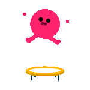
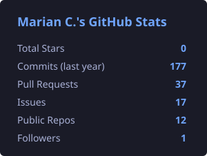
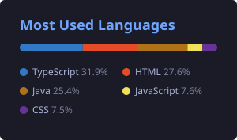

<!-- ===== HEADER ===== -->

  

<h1 align="center">Hi! 👋 I'm Marian</h1>

  

<h3 align="center"> Full Stack Developer | QA Enthusiast | Passion for Development 🔥</h3>

  

  
  

<!-- Snake: generado por .github/workflows/snake.yml -->

  <picture>
    <source media="(prefers-color-scheme: dark)" srcset="https://raw.githubusercontent.com/MarianC-programing/MarianC-programing/output/github-snake-dark.svg" />
    <source media="(prefers-color-scheme: light)" srcset="https://raw.githubusercontent.com/MarianC-programing/MarianC-programing/output/github-snake.svg" />
    
  </picture>

---

### 👨‍💻 About Me

I'm a Software Engineering student at **UTP (Panama)** with a strong technical background in **IT support**. I combine my hardware diagnostic skills with software logic.

- Based in **Panama** 🇵🇦
- Currently improving my **Full Stack** skills
- Pivoting towards **Quality Assurance** (Selenium, Cypress, manual testing)
- Experienced in **Windows** and **Linux** environments
- Open to collaborating on exciting projects
- Love writing clean, scalable code

---

### 📬 Connect with Me

  
  
  

---

### Tech Stack & Tools

**🌐 Languages, Frameworks & Engines**

  

**🧪 Quality Assurance & Testing**

  
  
  
  

**🧠 Databases, DevOps & Design**

  

**🖥️ Operating Systems & IT Support**

  
  

---

### 🏆 Achievements & GitHub Overview

  

  
  
  

---

<i>"The best way to predict the future is to create it."</i>

  

